  <picture>
    <source media="(prefers-color-scheme: dark)" srcset="https://raw.githubusercontent.com/MiguelCock/MiguelCock/main/assets/banner-dark.svg">
    <source media="(prefers-color-scheme: light)" srcset="https://raw.githubusercontent.com/MiguelCock/MiguelCock/main/assets/banner-light.svg">
    
  </picture>

  
  
  
  
  

## $ whoami

Cybersecurity engineer at **Exfil Security**, a US security company, working remotely from Medellín. I split my time between security testing and internal product work.

I studied Systems Engineering at **EAFIT**, stayed for a specialization in software development, and I'm finishing a master's in engineering. I like turning real problems into working software — **Flutter** apps for accessibility, **Python** services on the backend, and **JavaScript/TypeScript** interfaces that stay clear and usable.

**Now**

- Security testing and internal product work at **Exfil Security** (remote, US)
- Finishing an **M.Sc. in Engineering** at EAFIT
- Building practical apps with **Flutter**, **Python**, and **TypeScript**

## $ ls ./stack

<table>
  <tr>
    <td valign="top"><code>security</code></td>
    <td>
      
      
      
      
      
      
      
    </td>
  </tr>
  <tr>
    <td valign="top"><code>languages</code></td>
    <td>
      
      
      
      
      
      
      
      
      
    </td>
  </tr>
  <tr>
    <td valign="top"><code>backend</code></td>
    <td>
      
      
      
    </td>
  </tr>
  <tr>
    <td valign="top"><code>frontend</code></td>
    <td>
      
      
      
    </td>
  </tr>
  <tr>
    <td valign="top"><code>data</code></td>
    <td>
      
      
      
      
    </td>
  </tr>
  <tr>
    <td valign="top"><code>cloud / ops</code></td>
    <td>
      
      
      
      
      
    </td>
  </tr>
  <tr>
    <td valign="top"><code>creative</code></td>
    <td>
      
      
      
      
    </td>
  </tr>
</table>

## $ cat experience.log

**Exfil Security** — Cybersecurity Engineer & Full-Stack Developer \
Jan 2025 – present · Remote, US

The work is a mix of pentesting and internal product engineering: a SOW generator and a RAG chatbot over internal documentation in React, AWS infrastructure provisioned with Terraform, and data in DynamoDB and PostgreSQL/Supabase. I work in English with US teams and clients.

**Universidad Icesi · 4U** — Lead Full-Stack Developer \
Sep – Nov 2026 · Cali, CO

A three-month contract to take 4U from idea to a working accessibility product: seven FastAPI microservices behind one gateway, vision-corrected GPS with place-recognition embeddings and an unscented Kalman filter, a Flutter app with spoken navigation, and AWS EC2 deployment with GitHub Actions.

**EAFIT** — Systems Engineering and Software Development \
2020 – 2027 · Medellín, CO

M.Sc. in Engineering (in progress, 2026–27) · Specialization in Software Development (2026) · B.Sc. in Systems Engineering (2025).

## $ cat certifications.txt

<b>Certifications and recognition</b> — TryHackMe, APIsec University, Inventiva

**TryHackMe**

- Junior Penetration Tester
- Cyber Security 101
- Web Fundamentals
- Pre Security

**APIsec University**

- Securing LLM and NLP APIs
- API Security for PCI Compliance
- API Security Fundamentals '25
- Getting Started in API Pen Testing

**Recognition**

- Inventiva 2024-1 · Best Performance — DnD-AI, an AI dungeon master with an interactive map and multiplayer combat.

## $ ./stats --public

  <picture>
    <source media="(prefers-color-scheme: dark)" srcset="https://github-readme-stats.vercel.app/api?username=MiguelCock&amp;show_icons=true&amp;include_all_commits=true&amp;hide_rank=true&amp;hide=contribs&amp;number_format=short&amp;locale=en&amp;disable_animations=true&amp;bg_color=05070a&amp;title_color=5df2a5&amp;text_color=d9e6ef&amp;icon_color=6ee7ff&amp;border_color=1b2733&amp;border_radius=6&amp;card_width=460">
    <source media="(prefers-color-scheme: light)" srcset="https://github-readme-stats.vercel.app/api?username=MiguelCock&amp;show_icons=true&amp;include_all_commits=true&amp;hide_rank=true&amp;hide=contribs&amp;number_format=short&amp;locale=en&amp;disable_animations=true&amp;bg_color=ffffff&amp;title_color=1a7f37&amp;text_color=1f2328&amp;icon_color=0969da&amp;border_color=d0d7de&amp;border_radius=6&amp;card_width=460">
    
  </picture>
    
  <picture>
    <source media="(prefers-color-scheme: dark)" srcset="https://github-readme-stats.vercel.app/api/top-langs?username=MiguelCock&amp;layout=compact&amp;langs_count=8&amp;hide=html%2Ccss%2Cc&amp;locale=en&amp;custom_title=Most+Used+Languages&amp;disable_animations=true&amp;bg_color=05070a&amp;title_color=5df2a5&amp;text_color=d9e6ef&amp;border_color=1b2733&amp;border_radius=6&amp;card_width=460">
    <source media="(prefers-color-scheme: light)" srcset="https://github-readme-stats.vercel.app/api/top-langs?username=MiguelCock&amp;layout=compact&amp;langs_count=8&amp;hide=html%2Ccss%2Cc&amp;locale=en&amp;custom_title=Most+Used+Languages&amp;disable_animations=true&amp;bg_color=ffffff&amp;title_color=1a7f37&amp;text_color=1f2328&amp;border_color=d0d7de&amp;border_radius=6&amp;card_width=460">
    
  </picture>

## $ ./contributions

  <picture>
    <source media="(prefers-color-scheme: dark)" srcset="https://raw.githubusercontent.com/MiguelCock/MiguelCock/output/snake-dark.svg?v=1">
    <source media="(prefers-color-scheme: light)" srcset="https://raw.githubusercontent.com/MiguelCock/MiguelCock/output/snake-light.svg?v=1">
    
  </picture>

## $ ./contact --now

Open to full-stack roles and interesting security work in Medellín. The fastest way to reach me is LinkedIn.

  
  

